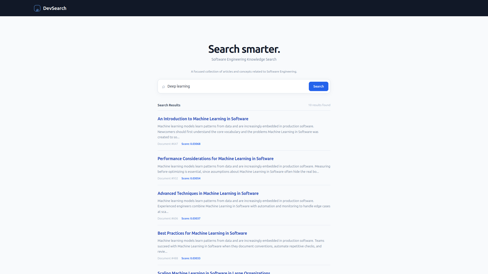
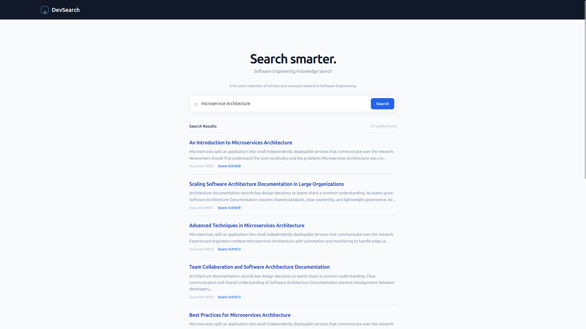

# Hybrid Search Engine

A Java-based hybrid search engine built with **Spring Boot** that explores how modern information retrieval systems work under the hood.

DevSearch combines traditional keyword-based retrieval using **BM25** with semantic retrieval using **Sentence-BERT (SBERT)** to find relevant documents through both exact keyword matches and contextual meaning.

The project implements BM25 scoring, cosine similarity, and Reciprocal Rank Fusion (RRF) independently rather than relying on prebuilt search engines such as Apache Lucene or Elasticsearch for ranking.

It also provides a REST API and a minimal web interface for searching a collection of software engineering articles.

## 🚀 Features

- **Custom BM25 Implementation:** Keyword-based document ranking implemented from scratch.
- **Semantic Search:** Uses Sentence-BERT embeddings to understand contextual meaning.
- **Cosine Similarity:** Calculates similarity between query and document embeddings.
- **Hybrid Retrieval:** Combines lexical and semantic search results.
- **Reciprocal Rank Fusion:** Merges rankings from BM25 and SBERT.
- **REST API:** Exposes search functionality through Spring Boot.
- **Web Interface:** Minimal frontend for submitting queries and viewing ranked results.
- **In-Memory Retrieval:** Stores document embeddings in memory without requiring an external vector database.

## 🏗️ Architecture

The search engine follows a hybrid retrieval pipeline:

```text
                   Documents
                       |
                       v
                 Document Loading
                       |
                       v
                  Preprocessing
                       |
              +--------+--------+
              |                 |
              v                 v
            BM25              SBERT
              |                 |
              v                 v
       Keyword Search    Semantic Search
              |                 |
              +--------+--------+
                       |
                       v
                 Hybrid Search
                       |
                       v
           Reciprocal Rank Fusion
                       |
                       v
                 Final Results
                       |
                       v
                  REST API
                       |
                       v
                 DevSearch UI
```

## 🛠️ Tech Stack

| Technology | Purpose |
|---|---|
| Java 21 | Core programming language |
| Spring Boot | Backend application and REST API |
| Spring AI | Embedding model integration |
| all-MiniLM-L6-v2 | Semantic embedding generation |
| Maven | Dependency management |
| Apache Commons CSV | CSV document ingestion |
| Cosine Similarity | Semantic similarity calculation |
| HTML, CSS, JavaScript | Frontend |
| Git & GitHub | Version control |

## 📚 Core Components

### 1. Document Processing

Documents are loaded from a CSV dataset containing software engineering-related articles.

Each document contains:
- Document ID
- Title
- Content

Before lexical retrieval, documents undergo preprocessing:

- Lowercase conversion.
- Special character removal.
- Tokenization.
- Document length calculation.

The tokenizer converts text into a list of normalized terms used by the BM25 retrieval system.

### 2. BM25 Search

BM25 (Best Matching 25) is a probabilistic ranking function widely used in information retrieval systems.

It ranks documents based on query-term frequency, inverse document frequency, and document length normalization.

**BM25 Scoring Formula:**

$$
Score(D,Q) = \sum_{t \in Q} IDF(t) \cdot
\frac{f(t,D)(k_1+1)}
{f(t,D)+k_1\left(1-b+b\frac{|D|}{avgdl}\right)}
$$

**BM25 IDF Formula:**

$$
IDF(t) = \ln\left(1+\frac{N-df(t)+0.5}{df(t)+0.5}\right)
$$

Where:

- `f(t,D)` = Frequency of term `t` in document `D`.
- `|D|` = Document length.
- `avgdl` = Average document length across the collection.
- `N` = Total number of documents.
- `df(t)` = Number of documents containing term `t`.
- `k1` = Controls term frequency saturation.
- `b` = Controls document length normalization.

The BM25 scoring and ranking logic is implemented from scratch without using Lucene or Elasticsearch.

### 3. Semantic Search with SBERT

Semantic search retrieves documents based on contextual meaning rather than relying exclusively on exact keyword matches.

The project uses **all-MiniLM-L6-v2** to generate dense vector embeddings for documents and search queries.

The model generates 384-dimensional embeddings representing the semantic information in the input text.

Document embeddings are generated during application initialization and stored in memory.

For a search query:

1. Generate an embedding for the query.
2. Compare it against stored document embeddings.
3. Calculate cosine similarity.
4. Rank documents by similarity score.

**Cosine Similarity Formula:**

$$
Similarity(A,B) =
\frac{A \cdot B}
{\|A\| \times \|B\|}
$$

Where:

- `A` = Query embedding.
- `B` = Document embedding.
- `A · B` = Dot product of the vectors.
- `||A||` and `||B||` = Vector magnitudes.

This allows the search engine to retrieve relevant documents even when the query and document use different words with similar meanings.

### 4. Hybrid Search

Hybrid search combines two retrieval approaches:

- **BM25:** Keyword-based retrieval.
- **SBERT:** Semantic retrieval.

BM25 helps identify documents containing relevant terms, while SBERT identifies documents with similar contextual meaning.

Combining both approaches helps improve retrieval beyond relying on either method independently.

### 5. Reciprocal Rank Fusion (RRF)

Reciprocal Rank Fusion combines ranked results from multiple retrieval systems into a unified ranking.

Instead of directly combining BM25 and cosine similarity scores, RRF uses the position of each document in the individual rankings.

**RRF Formula:**

$$
RRF(d) = \sum_{r \in R}
\frac{1}{k + rank_r(d)}
$$

Where:

- `d` = Document.
- `R` = Set of ranking systems.
- `rank_r(d)` = Position of document `d` in ranking system `r`.
- `k` = Ranking constant, set to 60.

The implementation accumulates contributions from BM25 and semantic search using document IDs, then sorts documents by their final RRF scores.

## 🖥️ Application Screenshots

DevSearch provides a minimal web interface for searching software engineering articles and viewing results from the hybrid retrieval pipeline.

### Search Interface

<p align="center">
  
</p>

### Search Results

<p align="center">
  
</p>

## 📂 Project Structure

```text
WikiSearchEngine/
│
├── src/
│   ├── main/
│   │   ├── java/
│   │   │   └── org/example/
│   │   │       │
│   │   │       ├── controller/
│   │   │       │   └── SearchController.java
│   │   │       │
│   │   │       ├── ingestion/
│   │   │       │   └── DocumentLoader.java
│   │   │       │
│   │   │       ├── model/
│   │   │       │   ├── Document.java
│   │   │       │   └── SearchResult.java
│   │   │       │
│   │   │       ├── preprocessing/
│   │   │       │   └── Tokenizer.java
│   │   │       │
│   │   │       ├── retrieval/
│   │   │       │   ├── BM25.java
│   │   │       │   ├── DocumentFrequency.java
│   │   │       │   ├── IDFCalculator.java
│   │   │       │   ├── SemanticSearch.java
│   │   │       │   └── ReciprocalRankFusion.java
│   │   │       │
│   │   │       ├── service/
│   │   │       │   ├── EmbeddingService.java
│   │   │       │   └── SearchService.java
│   │   │       │
│   │   │       └── Main.java
│   │   │
│   │   └── resources/
│   │       ├── static/
│   │       │   └── index.html
│   │       ├── documents.csv
│   │       └── application.properties
│   │
│   └── test/
│
├── screenshots/
│   ├── capture1.png
│   └── capture2.png
│
├── pom.xml
└── README.md
```

*The structure above reflects the main application components. Additional configuration and test files may exist.*

## 🔌 API Usage

The application exposes a search endpoint through Spring Boot.

**Endpoint:**

```http
GET /api/search?q=microservices
```

**Example:**

```bash
curl "http://localhost:8080/api/search?q=microservices"
```

The API returns a ranked JSON response containing document information and the corresponding hybrid RRF score.

## 🚀 Getting Started

### Prerequisites

- Java 21 or later.
- Maven 3.8 or later.
- Git.

### 1. Clone the Repository

```bash
git clone https://github.com/harsh-2093/WikiSearchEngine.git

cd WikiSearchEngine
```

### 2. Build the Project

```bash
mvn clean install
```

### 3. Run the Application

```bash
mvn spring-boot:run
```

The Spring Boot application starts on:

```text
http://localhost:8080
```

### 4. Open DevSearch

Visit the following URL in your browser:

```text
http://localhost:8080/
```

Enter a software engineering-related query to retrieve relevant documents using the hybrid search pipeline.

## 🗺️ Development Roadmap

- [x] Initialize Spring Boot project.
- [x] Create Document model.
- [x] Implement document loading from CSV.
- [x] Implement tokenizer.
- [x] Implement Document Frequency calculation.
- [x] Implement BM25 IDF calculation.
- [x] Implement BM25 scoring and ranking from scratch.
- [x] Integrate SBERT using all-MiniLM-L6-v2.
- [x] Implement embedding generation.
- [x] Implement cosine similarity.
- [x] Develop semantic search.
- [x] Implement hybrid retrieval.
- [x] Implement Reciprocal Rank Fusion.
- [x] Expose search functionality through REST API.
- [x] Build DevSearch frontend.
- [ ] Add comprehensive automated test coverage.
- [ ] Evaluate retrieval quality using sample queries.
- [ ] Optimize document indexing and retrieval performance.

## 🧪 Testing and Evaluation

The retrieval components can be evaluated independently and as part of the complete hybrid pipeline.

Planned test coverage:

- Tokenization.
- Document frequency calculation.
- IDF calculation.
- BM25 scoring and ranking.
- Embedding generation.
- Cosine similarity.
- Semantic search.
- Reciprocal Rank Fusion.
- Hybrid retrieval quality.

## 💡 Learning Outcomes

This project focuses on developing a practical understanding of:

- Information Retrieval fundamentals.
- Probabilistic ranking models.
- BM25 implementation.
- Dense vector representations.
- Sentence embeddings.
- Semantic similarity.
- Hybrid information retrieval.
- Reciprocal Rank Fusion.
- REST API development using Java and Spring Boot.

## 📌 Project Status

**Under Development**

The core hybrid retrieval pipeline and web interface are implemented. Further work focuses on automated testing, retrieval evaluation, and performance improvements.

The primary objective is to understand and implement the underlying retrieval algorithms rather than relying entirely on existing search-engine libraries.

---

**Author:** Harsh Tripathi

**GitHub:** [harsh-2093](https://github.com/harsh-2093)

**Repository:** [WikiSearchEngine](https://github.com/harsh-2093/WikiSearchEngine)